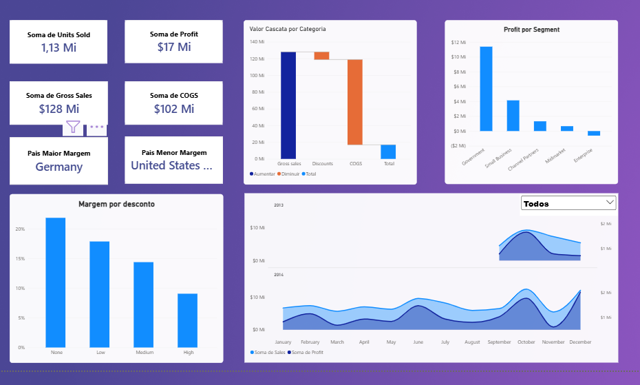
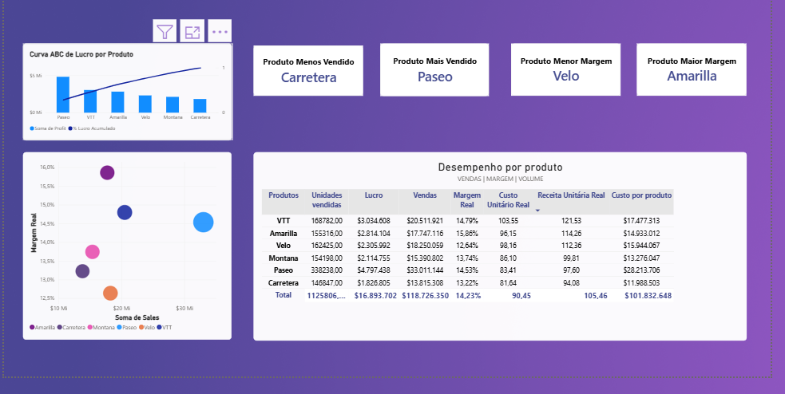
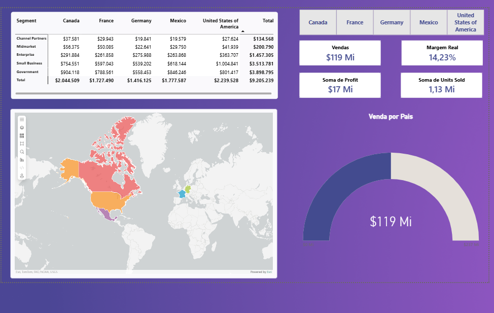

# 📊 Painel de Performance de Vendas — Power BI

> Dashboard executivo construído no Power BI Desktop a partir do dataset sintético "Financial Sample" da Microsoft, com foco em modelagem DAX, storytelling financeiro (ponte de receita a lucro) e boas práticas de design de relatório.

---

## 🇧🇷 Sobre o projeto

Este é meu primeiro dashboard completo em Power BI, construído do zero como peça de portfólio. O objetivo não foi só "colocar gráfico na tela", mas simular o que um analista entregaria de fato para a diretoria de uma empresa: uma visão executiva de topo, seguida de análises de detalhe por produto e por país — sem repetir o mesmo cruzamento de dado em páginas diferentes.

### Estrutura do relatório

O arquivo tem 3 páginas:

**1. Executiva** — visão de topo para tomada de decisão rápida:
- 4 cartões de KPI (Vendas em Unidades, Receita Bruta, COGS, Lucro)
- Gráfico de **Cascata (Waterfall)**: Gross Sales → Discounts → COGS → Lucro — a ponte financeira que mostra visualmente onde o dinheiro se perde entre a receita bruta e o lucro líquido
- Lucro por Segmento de cliente, ranqueado
- Margem Real por Faixa de Desconto, ranqueado (resposta à pergunta "estamos dando desconto demais?")
- Tendência de Vendas e Lucro por mês, comparando os dois anos disponíveis lado a lado (em vez de um índice de mês sem significado)
- Cartões de destaque: país com maior e menor margem real (medidas DAX dinâmicas, não valores fixos)

**2. Analise de produto** — tabela dinâmica e dispersão (Margem Real × Vendas × Unidades) por produto, 4 cartões de destaque (mais/menos vendido, maior/menor margem) e uma **Curva ABC de Lucro** (Pareto) mostrando quanto do lucro total está concentrado nos primeiros produtos — para quem precisa investigar o "porquê" por trás dos números da aba executiva.

**3. Analise por país** — mapa, indicadores por país, tabela de desconto por segmento e país.

### Destaques técnicos (DAX)

Os pontos que exigiram mais raciocínio de modelagem, documentados em detalhe em [`docs/DAX-MEASURES.md`](docs/DAX-MEASURES.md):

- Gráfico de cascata construído sobre uma tabela-ponte própria (`Cascata`) com uma medida `SWITCH` que remapeia cada categoria da ponte financeira para o valor correto, com sinal invertido nos itens de dedução;
- Duas medidas de "maior/menor valor dinâmico" (país com maior e menor margem) usando `TOPN` + `CONCATENATEX`, sem depender de filtro Top N no visual — atualizam sozinhas se os dados mudarem;
- Interações entre visuais editadas manualmente (`Editar interações`) para impedir que um slicer decorativo filtrasse os cartões de destaque.

### Fonte de dados

Dataset "Financial Sample" (Microsoft), sintético, usado apenas para fins de demonstração. Não representa dados reais de nenhuma empresa.

### Como abrir

Requer o **Power BI Desktop para Windows** (versão de setembro/2026 ou mais recente — o arquivo usa o formato de relatório aprimorado / PBIR). Basta abrir `Tabela_Vendas.pbix` para explorar os dados já importados.

### Como atualizar os dados em outra máquina

As consultas `financials` e `Sheet1` usam o arquivo local `C:\Program Files\Microsoft Power BI Desktop\bin\SampleData\Financial Sample.xlsx`. Se esse caminho não existir na sua instalação, será necessário alterar a fonte antes de atualizar:

1. Baixe o [Financial Sample.xlsx pela página oficial da Microsoft](https://learn.microsoft.com/pt-br/power-bi/create-reports/sample-financial-download) e salve-o em uma pasta local. Preserve a tabela `financials`, a aba `Sheet1` e os nomes das colunas.
2. No Power BI Desktop, abra **Transformar dados → Configurações da fonte de dados** e selecione a fonte Excel do arquivo atual. Em **Alterar fonte**, escolha o arquivo baixado.
3. Confira a etapa `Source` nas duas consultas (`financials` e `Sheet1`): ambas devem apontar para o novo caminho. Mantenha as etapas de navegação e de tipos existentes.
4. Use **Fechar e Aplicar** e depois **Atualizar**. Com a amostra original, as duas consultas devem carregar 700 registros cada.

Abrir o `.pbix` usa os dados já armazenados nele; atualizar os dados requer acesso à fonte Excel.

---

## 🇺🇸 About this project

This is my first end-to-end Power BI dashboard, built from scratch as a portfolio piece using Microsoft's synthetic "Financial Sample" dataset. The goal was to simulate what an analyst would actually hand to leadership: a top-level executive view, followed by drill-down pages for product and country — without repeating the same chart across tabs.

### Report structure

The file has 3 pages:

**1. Executiva (Executive)** — top-level view for fast decision-making:
- 4 KPI cards (Units Sold, Gross Sales, COGS, Profit)
- **Waterfall chart**: Gross Sales → Discounts → COGS → Profit — the financial bridge showing exactly where money is lost between gross revenue and net profit
- Profit by customer Segment, ranked
- Real Margin by Discount Band, ranked (answers "are we over-discounting?")
- Sales & Profit trend by month, comparing both years side by side (instead of a meaningless month index)
- Highlight cards: country with the highest and lowest real margin (dynamic DAX measures, not hardcoded values)

**2. Analise de produto (Product analysis)** — pivot table and scatter plot (Real Margin × Sales × Units) per product, 4 highlight cards (best/worst seller, highest/lowest margin) and an **ABC Profit Curve** (Pareto) showing how much of total profit is concentrated in the top products — for anyone who needs to dig into the "why" behind the executive numbers.

**3. Analise por país (Country analysis)** — map, per-country KPIs, discount-by-segment-and-country table.

### Technical highlights (DAX)

The parts that required the most modeling thought are documented in [`docs/DAX-MEASURES.md`](docs/DAX-MEASURES.md):

- The waterfall chart is built on a purpose-made bridge table (`Cascata`) with a `SWITCH` measure that maps each bridge category to the correct signed value;
- Two "dynamic top/bottom" measures (highest/lowest-margin country) using `TOPN` + `CONCATENATEX` instead of a visual-level Top N filter — they stay correct automatically if the data changes;
- Visual interactions manually edited (`Edit interactions`) so a decorative slicer doesn't filter the highlight cards.

### Data source

Microsoft's "Financial Sample" dataset — synthetic, used for demonstration purposes only. Does not represent real data from any company.

### How to open

Requires **Power BI Desktop for Windows** (September 2026 build or newer — the file uses the enhanced report format / PBIR). Open `Tabela_Vendas.pbix` to explore the already imported data.

### Refreshing data on another machine

The `financials` and `Sheet1` queries use the local file `C:\Program Files\Microsoft Power BI Desktop\bin\SampleData\Financial Sample.xlsx`. If that path does not exist in your installation, change the source before refreshing:

1. Download [Financial Sample.xlsx from Microsoft's official page](https://learn.microsoft.com/en-us/power-bi/create-reports/sample-financial-download) and save it to a local folder. Preserve the `financials` table, the `Sheet1` worksheet and the column names.
2. In Power BI Desktop, open **Transform data → Data source settings** and select the Excel source for the current file. Use **Change Source** to choose the downloaded workbook.
3. Check the `Source` step in both queries (`financials` and `Sheet1`): both should point to the new path. Keep the existing navigation and type conversion steps.
4. Select **Close & Apply**, then **Refresh**. With the original sample, each query should load 700 rows.

Opening the `.pbix` uses its stored data; refreshing requires access to the Excel source.

---

## 📸 Screenshots

**Executiva**


**Analise de produto**


**Analise por país**


---

## 📁 Estrutura do repositório / Repository structure

```
.
├── Tabela_Vendas.pbix          # arquivo do Power BI / Power BI file
├── README.md
└── docs/
    ├── DAX-MEASURES.md         # medidas DAX documentadas / documented DAX measures
    └── screenshots/
        ├── executiva.png
        ├── analise-produto.png
        └── analise-pais.png
```

## 📜 Licença / License

Uso educacional / de portfólio. O dataset de origem é fictício (Microsoft Financial Sample). / Educational / portfolio use. Source dataset is fictional (Microsoft Financial Sample).
